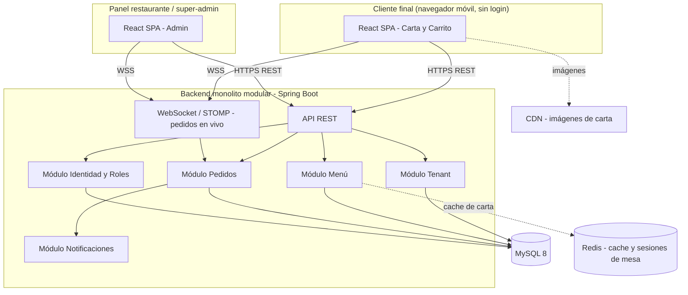
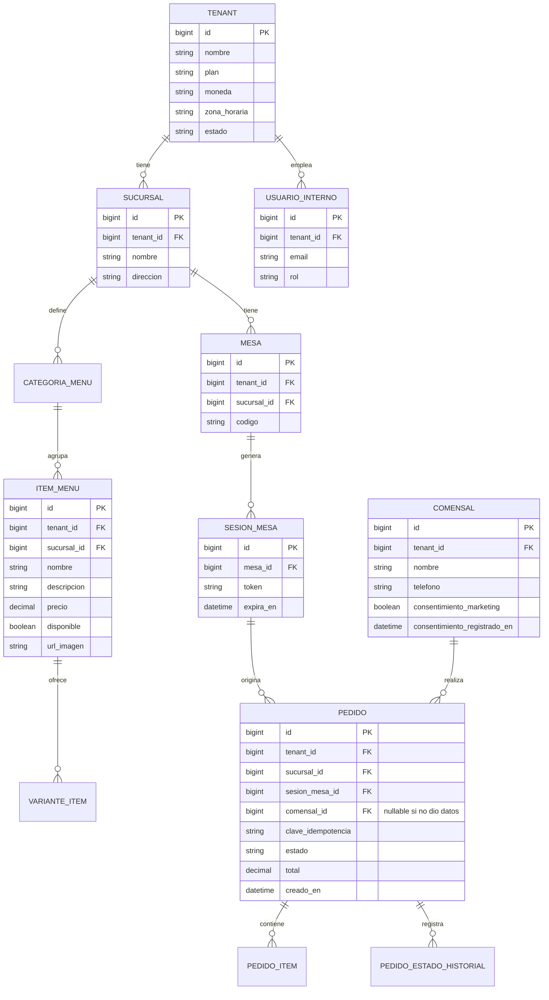

# Documentación Técnica — SaaS de Carta Digital y Comanda para Restaurantes

**Stack decidido:** Java (Spring Boot) + React + MySQL — Equipo: 2 desarrolladores (Java/React senior + Java/Python)
**Modelo:** SaaS multi-tenant · **Alcance MVP:** Carta digital + comanda desde la mesa (sin pagos online)
**País de operación:** Colombia (único, por ahora) · **Pricing:** suscripción mensual fija por sucursal · **Dato del comensal:** nombre + teléfono (CRM/fidelización futura) · **Soporte MVP:** manual (WhatsApp/teléfono de los fundadores)
**Fecha:** Agosto 2026 — v1.1, con las decisiones de la sección 15 ya cerradas

---

## 0. Resumen ejecutivo — y lo que el plan original no resuelve

Antes de entrar en arquitectura, hay que decir esto con claridad: el brief inicial ("carta tipo TikTok que vi", "que sea escalable para chicos y grandes", "Java y React") define una dirección, no un producto. Lo que sigue en este documento traduce eso en decisiones concretas, pero quedan riesgos que **no son técnicos y que ustedes no han resuelto todavía**:

1. **Están vendiendo antes de tener producto validado.** El video muestra prospección en frío a un restaurante (Opulento) sin evidencia de que el software exista o esté probado en producción. Prevender está bien como estrategia, pero si le prometen "comanda digital" a un dueño de restaurante y tardan 4 meses en tenerla estable, pierden ese cliente y la reputación boca a boca en un sector donde los dueños se conocen entre sí.
2. **"Escalable para chicos y grandes" no es un requisito, es una aspiración.** Sin definir *qué límites separan un plan chico de uno grande* (nº de sucursales, mesas, pedidos/mes), no se puede dimensionar ni el modelo de datos ni el pricing. Este documento propone una estructura de planes en la sección 1.2, pero **ustedes tienen que fijar los números reales**, no yo.
3. **No han decidido en qué país(es) van a operar de verdad.** Esto no es un detalle: en Colombia, Argentina y México la facturación electrónica, la protección de datos personales y hasta el IVA sobre servicios digitales tienen reglas distintas. Si el plan es "chicos y grandes en toda LatAm", están subestimando el trabajo de compliance. Ver sección 15.
4. **Dos desarrolladores construyendo un SaaS multi-tenant con comanda en tiempo real es un alcance ambicioso para el tamaño del equipo.** No es imposible, pero exige que el MVP sea brutalmente más chico de lo que probablemente están imaginando. La sección 13 (roadmap) es la parte más importante de todo este documento — léanla antes que el resto si tienen prisa.

El resto del documento asume que aceptan estas advertencias y avanza con decisiones concretas.

---

## 1. Visión de producto y modelo de negocio

### 1.1 Qué es, y qué NO es

Es una plataforma SaaS donde un restaurante escanea un QR por mesa, ve la carta digital y **hace el pedido desde el celular**, que llega en vivo al mesero o a cocina. No es solo una "carta bonita" — eso ya lo regalan varios competidores (Menuly, entre otros, según el propio video de referencia) y compite exclusivamente por precio y diseño, terreno perdido para un equipo de 2 personas sin presupuesto de marketing.

El diferenciador real que ustedes eligieron es la **comanda digital**: reducir tiempos de toma de pedido y errores de mesero. Ese es el argumento de venta, no "tenemos una carta con fotos".

Explícitamente fuera del producto en esta fase: pagos online, reservas, fidelización/CRM, integraciones con POS existentes, facturación electrónica automática, pantallas dedicadas de cocina (KDS físico). Todo eso es real y probablemente lo van a necesitar, pero no en el MVP (ver sección 2 y 13).

### 1.2 Estructura de planes (para resolver "chicos y grandes")

**Decisión cerrada: suscripción mensual fija por sucursal.** Esto simplifica la facturación (no hay que medir consumo en tiempo real para cobrar, a diferencia de un modelo freemium por volumen) pero tiene una consecuencia que hay que aceptar de entrada: **el precio no varía con cuánto usa el restaurante el sistema**, así que los límites de plan no son un mecanismo de cobro por uso, son un mecanismo de **segmentación de producto** (qué tan grande es la operación que soporta cada plan) y de protección técnica (evitar que un solo tenant grande consuma recursos desproporcionados de la infraestructura compartida, ver §9 "vecino ruidoso").

La forma correcta de que un mismo sistema sirva a un restaurante de barrio y a una cadena no es construir "dos productos" ni sobre-diseñar el MVP para escala enterprise que no tienen todavía. Es **una sola arquitectura multi-tenant con límites configurables por plan**:

| Plan (nombre provisional) | Sucursales | Mesas activas | Pedidos/mes | Usuarios internos | Precio mensual/sucursal |
|---|---|---|---|---|---|
| Starter | 1 | hasta 15 | hasta 1.500 | 3 | **[definir — ver nota]** |
| Pro | hasta 5 | hasta 60 | hasta 8.000 | 15 | **[definir]** |
| Enterprise | ilimitadas | ilimitadas | a medida | ilimitados | **[definir, a medida]** |

**El precio en COP sigue sin definirse — eso no lo resuelve la arquitectura, lo resuelve un análisis de costo de infraestructura por tenant + lo que el mercado colombiano de restaurantes está dispuesto a pagar.** No lo inventen a ciegas: calculen cuánto cuesta servir a un tenant Starter (hosting, soporte manual incluido) antes de fijar el número, o van a subsidiar clientes sin darse cuenta. Arquitectónicamente, lo importante es que estos límites se apliquen **a nivel de aplicación** (chequeos antes de crear una sucursal, mesa o usuario nuevo), no que existan dos bases de código distintas para "chico" y "grande".

---

## 2. Alcance funcional del MVP

### Incluido

- **Carta digital**: categorías, ítems con foto/descripción/precio, variantes (tamaño, extras), disponibilidad en tiempo real (marcar "agotado" sin borrar el ítem).
- **Comanda digital desde la mesa**: el cliente arma un carrito y lo envía; el pedido llega en vivo al panel del restaurante con el número de mesa.
- **Panel del restaurante**: gestión de carta, gestión de mesas (generación de QR por mesa), vista de pedidos en vivo con cambio de estado (recibido → en preparación → entregado), gestión de usuarios internos con roles.
- **Panel super-admin (de ustedes)**: alta/baja de restaurantes (tenants), asignación de plan, ver uso vs. límites del plan.

### Explícitamente NO incluido en el MVP

Pagos online, reservas de mesa, KDS con pantallas dedicadas, facturación electrónica, programas de fidelización, integración con POS/caja existente, soporte multi-idioma activo (se deja preparado en el modelo de datos, no se construye la UI), analítica avanzada más allá de reportes básicos.

Si el equipo comercial promete algo de esta lista a un cliente antes de que exista, ese es un riesgo de negocio que va a aterrizar directo en el equipo técnico como presión de fecha. Díganlo así de claro puertas adentro.

---

## 3. Requisitos funcionales (por módulo)

| ID | Módulo | Requisito |
|---|---|---|
| RF-01 | Carta | El cliente ve la carta sin necesidad de login, accediendo vía QR único por mesa. |
| RF-02 | Carta | Los ítems agotados se muestran visualmente distintos (no desaparecen) y no pueden agregarse al carrito. |
| RF-03 | Comanda | El cliente arma un carrito y lo confirma; el sistema genera un pedido asociado a `tenant + sucursal + mesa`. |
| RF-04 | Comanda | Cada envío de pedido lleva una clave de idempotencia generada en el cliente para evitar duplicados por doble tap o reintento de red. |
| RF-05 | Comanda | El precio final se recalcula siempre en el servidor contra la carta vigente; el payload del cliente nunca es fuente de verdad del precio. |
| RF-06 | Comanda | El restaurante ve los pedidos entrantes en tiempo real (o casi) sin necesidad de refrescar manualmente. |
| RF-07 | Comanda | El mesero/cocina puede cambiar el estado de un pedido; el historial de cambios de estado queda registrado con timestamp y usuario. |
| RF-08 | Mesas | Cada mesa tiene un QR único que codifica un token de sesión de mesa, no solo el ID del restaurante. |
| RF-09 | Panel restaurante | Un usuario con rol `admin_restaurante` puede editar la carta; un rol `mesero` solo puede ver y actualizar estado de pedidos. |
| RF-10 | Multi-sucursal | Un tenant puede tener 1 o más sucursales; cada sucursal tiene su propia carta, mesas y pedidos, pero comparte el tenant y la facturación. |
| RF-11 | Super-admin | El super-admin puede suspender un tenant (por impago, por ejemplo) sin borrar sus datos. |
| RF-12 | Auditoría | Todo cambio de precio en la carta queda registrado (quién, cuándo, valor anterior/nuevo). |
| RF-13 | Comensal/CRM | Al confirmar el pedido, se captura nombre y teléfono del comensal, con casilla de consentimiento explícito para uso futuro de esos datos (fidelización/marketing) — ver nota de compliance en §10. |
| RF-14 | Comensal/CRM | El comensal puede confirmar el pedido sin dar nombre/teléfono si así lo decide el negocio (campo opcional) **a menos que** el restaurante configure ese dato como obligatorio para su operación (por ejemplo, para llamar al cliente si el pedido tiene un problema). |

Nota sobre RF-13/RF-14: ustedes decidieron capturar nombre y teléfono del comensal para CRM/fidelización futura, no el camino "pedido anónimo" que yo recomendaba para el MVP. Lo respeto como decisión de negocio, pero tiene un costo que no pueden dejar para después: desde el primer pedido capturado ya están tratando datos personales bajo el régimen de Habeas Data colombiano (Ley 1581 de 2012), lo que exige, como mínimo, aviso de privacidad, registro del consentimiento (no un checkbox marcado por defecto) y un mecanismo real para que el comensal pueda pedir que se borren sus datos. Esto es trabajo de Fase 1, no de Fase 4, precisamente porque decidieron capturar el dato desde el MVP.

Esta tabla es un punto de partida deliberadamente incompleto — cuando empiecen a construir van a descubrir requisitos que no están aquí (por ejemplo: ¿qué pasa con un pedido si el cliente cierra la pestaña antes de que el mesero lo confirme? ¿se cancela solo? ¿queda pendiente para siempre?). Añadan esos casos a esta tabla a medida que aparecen, no los resuelvan solo en el código.

---

## 4. Requisitos no funcionales

| Categoría | Requisito |
|---|---|
| Rendimiento | La carta debe cargar en menos de 2s en una red WiFi de restaurante típica (no fibra de oficina) — prueben con throttling real, no solo en localhost. |
| Disponibilidad | El sistema de carta+pedidos es crítico durante horario de servicio (12-15h y 19-23h aprox.). Una caída en sábado a las 21h es un incidente de negocio, no solo técnico. |
| Escalabilidad | La arquitectura debe soportar picos de tráfico concentrados (viernes/sábado noche) sin degradar tenants que no están en pico — ver §9, aislamiento de "vecino ruidoso". |
| Seguridad | Aislamiento estricto de datos entre tenants (ver §6). Ningún endpoint debe permitir acceder a datos de un tenant distinto al autenticado. |
| Usabilidad | El panel del restaurante debe ser operable por personal sin formación técnica, muchas veces bajo presión de servicio. No asuman que el usuario va a leer tooltips. |
| Auditabilidad | Cambios de precio, bajas de tenant y cambios de plan deben quedar trazados. |
| Internacionalización | Decidido: operación exclusiva en Colombia (COP, `America/Bogota`) mientras dure el MVP. Aun así, `moneda` y `zona_horaria` quedan como columnas por tenant (§7) en vez de constantes globales del sistema — es una fila más en un `INSERT`, no una migración, si el día de mañana entra un tenant en otro país. No construyan UI multi-país todavía: no hay decisión de negocio que lo justifique hoy (§15). |
| Protección de datos personales | Al capturar nombre y teléfono del comensal (RF-13), el sistema queda sujeto a Habeas Data (Ley 1581/2012, Colombia). Requiere: aviso de privacidad accesible en el flujo de pedido, registro auditable del consentimiento, y mecanismo de eliminación de datos a solicitud del titular. |

---

## 5. Arquitectura técnica

### 5.1 Decisión: monolito modular, no microservicios

Con 2 desarrolladores, una arquitectura de microservicios es un error de juicio, no una decisión de escala. Microservicios significan: múltiples repositorios o módulos desplegables por separado, service discovery, comunicación de red entre servicios (con todos sus fallos parciales), observabilidad distribuida, y N pipelines de CI/CD. Ninguna de esas cosas la sostiene un equipo de 2 personas sin que el tiempo de desarrollo de features caiga a la mitad por pura carga operativa.

La decisión correcta es un **monolito modular**: un único desplegable Spring Boot, organizado internamente en módulos con límites claros (paquetes o módulos Gradle/Maven separados: `tenant`, `menu`, `pedidos`, `identidad`, `notificaciones`). Si en 2-3 años un módulo específico (por ejemplo, notificaciones o comanda en tiempo real) necesita escalar independientemente, se extrae *entonces*, con datos reales de qué lo justifica — no antes.



### 5.2 Stack detallado

| Capa | Tecnología | Nota |
|---|---|---|
| Backend | Java 21 + Spring Boot 3 | LTS, ecosistema maduro, coherente con la experiencia del equipo. |
| Seguridad | Spring Security + JWT (access + refresh token) | El tenant se resuelve desde el claim del JWT, nunca desde un parámetro que el cliente pueda manipular. |
| Persistencia | Spring Data JPA + Hibernate | Ver §6 para la estrategia de filtrado por tenant — **este es el punto donde más fácil se filtran datos entre restaurantes si no se hace con disciplina**. |
| Migraciones DB | Flyway | Obligatorio desde el commit inicial. Nada de `ddl-auto: update` en ningún ambiente que no sea el laptop de desarrollo. |
| Base de datos | MySQL 8 | Coherente con la experiencia de ambos desarrolladores. |
| Cache / sesiones de mesa | Redis | Cache de carta (lectura muy frecuente, escritura poco frecuente) y almacenamiento de sesión de mesa con expiración. |
| Tiempo real | WebSocket (STOMP sobre SockJS) | Solo para el canal de "pedido nuevo" hacia el panel del restaurante. Evalúen si el MVP puede arrancar con *polling corto* (cada 5-8s) en vez de WebSocket — es más simple de operar con equipo chico y para un MVP con pocos tenants el ahorro de latencia no justifica la complejidad operativa todavía. |
| Frontend | React 18 + TypeScript + Vite | TS no es opcional en un equipo de 2 personas: sin tipos, el segundo desarrollador hereda bugs de contrato de API que un compilador atraparía gratis. |
| Estado / data fetching | TanStack Query | Evita reinventar cache de red y reintentos a mano. |
| Contenedores | Docker + docker-compose para desarrollo | Un solo `docker-compose up` debe levantar backend + MySQL + Redis para cualquiera de los dos devs. |
| CI/CD | GitHub Actions | Build + tests + lint en cada PR como mínimo no negociable. |
| Hosting sugerido | Un único VPS/instancia gestionada al inicio (ej. Railway, Render, o una instancia EC2/DigitalOcean simple) | No monten Kubernetes para 3 clientes piloto. Es sobre-ingeniería que va a consumir tiempo de desarrollo de producto. |

Sobre el Python del segundo desarrollador: no lo metan en el core transaccional (menú, pedidos, tenants). Resérvenlo para scripts auxiliares fuera del camino crítico (ETL de reportes, análisis de datos de uso) si en algún momento hace falta. Meter dos lenguajes en el backend principal de un equipo de 2 personas duplica la carga cognitiva para cero beneficio funcional en esta etapa.

---

## 6. Multi-tenancy: la decisión que define todo lo demás

Hay tres estrategias estándar:

| Estrategia | Aislamiento | Costo operativo | Encaja con... |
|---|---|---|---|
| **Schema compartido + `tenant_id`** | Bajo (a nivel de fila, aplicado por código) | Muy bajo — una sola base de datos | Planes Starter/Pro, muchos tenants pequeños |
| **Schema por tenant** (misma instancia MySQL) | Medio | Medio — migraciones deben correr N veces | Clientes medianos con requisitos de reporting propio |
| **Base de datos por tenant** | Alto | Alto — no escala operativamente a mano pasado un puñado de clientes | Enterprise con exigencias contractuales de aislamiento |

**Recomendación**: arrancar con **schema compartido + `tenant_id`** para todos los tenants, con la fila `tenant_id` presente en cada tabla del dominio de negocio y **enforcement centralizado** (un `Filter` de Hibernate o un aspecto que inyecta la condición de tenant en cada consulta, no confiar en que cada desarrollador se acuerde de agregar el `WHERE tenant_id = ?` a mano en cada repositorio nuevo). Dejar la puerta abierta a mover un tenant Enterprise específico a schema aislado más adelante si lo exige un contrato — pero no construir eso ahora.

**El riesgo #1 de este diseño, dicho sin rodeos**: una sola query sin el filtro de tenant es una fuga de datos entre restaurantes — el mesero del restaurante A ve pedidos del restaurante B. Esto no es hipotético, es el bug más común en SaaS multi-tenant mal implementados. Mitigación obligatoria, no opcional:

- Todo repositorio de acceso a datos de negocio pasa por una capa que aplica el filtro de tenant automáticamente (Hibernate `@Filter` a nivel de sesión, o un aspecto AOP).
- Test automatizado específico: "usuario del tenant A no puede leer ni escribir recursos del tenant B", corrido en cada build, no solo probado manualmente una vez.
- Ninguna query nativa (`@Query nativeQuery=true`) sin revisión explícita de que incluye el filtro de tenant.

---

## 7. Modelo de datos (entidades principales)



Notas de diseño que no son obvias mirando el diagrama:

- `tenant_id` se repite en tablas hijas (no solo en `sucursal`) **a propósito**: permite que el filtro de aislamiento de tenant se aplique de forma uniforme sin tener que hacer joins hacia arriba en cada query, lo cual es más rápido y más difícil de romper por error.
- `clave_idempotencia` en `PEDIDO` es lo que resuelve RF-04 (evitar pedidos duplicados).
- `PEDIDO_ITEM` debe guardar el precio **al momento del pedido**, copiado desde `ITEM_MENU`, no una referencia que se resuelva después — si el restaurante cambia el precio de un plato, los pedidos históricos no deben cambiar de valor retroactivamente.
- Borrado de `ITEM_MENU` referenciado por pedidos históricos: **soft delete** (`activo = false`), nunca hard delete, o van a romper la integridad referencial de pedidos pasados.
- `COMENSAL` es una entidad **por tenant, no global**: el mismo número de teléfono en dos restaurantes distintos son dos registros `COMENSAL` distintos, sin cruce de datos entre tenants — cualquier tentación de "unificar" comensales entre restaurantes para enriquecer un perfil global es, otra vez, una fuga de datos entre tenants (§6), esta vez de datos personales de terceros, que es peor. Ni lo consideren sin asesoría legal explícita.
- `comensal_id` en `PEDIDO` es nullable a propósito: RF-14 permite que el comensal no dé sus datos, así que el modelo no puede forzar la relación.

---

## 8. Diseño de API

Autenticación: JWT de acceso (vida corta, ~15 min) + refresh token (vida larga, rotable). El `tenant_id` viaja como claim dentro del JWT, resuelto en el login — nunca como parámetro de query o header que el cliente controle libremente.

| Método | Endpoint | Descripción |
|---|---|---|
| GET | `/api/publico/mesas/{token}/carta` | Carta vigente para una sesión de mesa, sin autenticación (público). |
| POST | `/api/publico/mesas/{token}/pedidos` | Crear pedido; requiere `clave_idempotencia` en el body. |
| GET | `/api/admin/menu/categorias` | Listar categorías de la sucursal del usuario autenticado. |
| POST/PUT | `/api/admin/menu/items` | Crear/editar ítems de carta. |
| PATCH | `/api/admin/menu/items/{id}/disponibilidad` | Marcar agotado/disponible. |
| GET | `/api/admin/pedidos?estado=` | Pedidos en vivo del panel. |
| PATCH | `/api/admin/pedidos/{id}/estado` | Cambiar estado de un pedido. |
| POST | `/api/admin/mesas` | Generar mesa + QR. |
| GET/POST | `/api/superadmin/tenants` | Alta y listado de tenants (uso exclusivo del equipo). |
| PATCH | `/api/superadmin/tenants/{id}/plan` | Cambiar plan/límites de un tenant. |

Canal WebSocket: `/ws/sucursales/{sucursalId}/pedidos` — el panel del restaurante se suscribe y recibe eventos `PEDIDO_CREADO` / `PEDIDO_ACTUALIZADO`. El backend valida que el usuario suscrito pertenece al `tenant`/`sucursal` antes de aceptar la suscripción (mismo riesgo de fuga entre tenants que en REST, aplica igual acá).

---

## 9. Casos límite que tienen que estar resueltos antes de llamarlo "MVP listo"

Nada de esto es opcional ni "para después" — son la diferencia entre un sistema que funciona en una demo y uno que sobrevive un sábado a la noche real:

- **Doble tap / reintento de red en el envío del pedido** → clave de idempotencia (RF-04). Sin esto, van a tener pedidos duplicados reales el primer fin de semana.
- **Precio manipulado desde el cliente** (alguien intercepta el request y cambia el precio en el payload) → el servidor jamás confía en el precio recibido, siempre recalcula contra la carta vigente (RF-05).
- **QR compartido o reusado a distancia** (alguien fotografía el QR y pide desde su casa) → la sesión de mesa (`SESION_MESA`) debe expirar en un tiempo razonable (ej. 3-4 horas) y, si el modelo de negocio lo justifica, regenerarse periódicamente. Decidan explícitamente si esto es un riesgo aceptable para el MVP (probablemente sí, dado que no hay pagos todavía) o no.
- **Caída de WiFi del restaurante a mitad de pedido** → el frontend debe distinguir claramente "no se pudo enviar, reintentando" de "se envió, esperando confirmación" — un error silencioso acá significa un cliente que cree que pidió y nunca llegó el pedido.
- **Pico de sábado a la noche de un tenant afectando a otros** (vecino ruidoso) → rate limiting por tenant a nivel de API gateway/aplicación, para que un restaurante con tráfico anómalo no degrade el servicio de los demás en la misma infraestructura compartida.
- **Cambio de menú mientras el cliente lo tiene abierto en el celular** → no es crítico resolverlo con websockets de carta (over-engineering para el MVP); alcanza con que el servidor sea la fuente de verdad al momento de confirmar el pedido (ya cubierto por RF-05).
- **Un tenant Starter crece de golpe a 40 sucursales** → el modelo de shared-schema debe soportar esto sin cambio de esquema; solo cambia el `plan` y los límites. La migración a schema aislado (si hiciera falta) es un proceso operativo aparte, no algo que el modelo de datos deba prever con código especial ahora.
- **Borrado de un ítem de menú con pedidos históricos** → soft delete, ya cubierto en §7.

---

## 10. Seguridad

- **Aislamiento de tenant**: tratado en §6, es el punto de seguridad más importante de todo el sistema y el más fácil de romper por descuido.
- **Contraseñas**: hash con BCrypt o Argon2, nunca texto plano ni MD5/SHA1 solos. Rate limiting en el endpoint de login para frenar fuerza bruta.
- **Inyección SQL**: usar JPA/Hibernate con parámetros; prohibir concatenación de strings en queries. Revisar en code review cualquier `@Query(nativeQuery = true)`.
- **Secretos**: variables de entorno o un gestor de secretos (ni credenciales de DB ni claves JWT hardcodeadas en el repo, ni en `application.yml` versionado).
- **CORS**: configurado explícitamente para los dominios del frontend, no `*` en producción.
- **Rol super-admin**: separado del resto de roles, con 2FA si es posible — es la cuenta que puede ver/tocar todos los tenants.
- **Auditoría**: cambios de precio, cambios de plan y suspensiones de tenant quedan registrados con usuario y timestamp (RF-12).
- **Datos personales del comensal (RF-13)**: al decidir capturar nombre y teléfono, `COMENSAL` (§7) requiere cifrado en reposo del teléfono (no es información pública como el nombre de un plato), acceso restringido por rol (un `mesero` no necesita ver el teléfono completo, un `admin_restaurante` sí), y un endpoint de borrado a solicitud del titular que efectivamente elimine el dato, no solo lo oculte en la UI.
- **Revocación de acceso a sucursal no es instantánea (nota agregada 2026-09-08, tras auditoría)**: la selección de sucursal de un MESERO (RF-10 PR4) vive en el claim `sucursalId` del access token JWT, no se re-valida contra la base en cada request. Si un ADMIN_RESTAURANTE desactiva una sucursal o le quita la asignación a un MESERO, ese MESERO sigue operando con normalidad sobre esa sucursal hasta que su access token expira (hasta `app.jwt.expiracion-acceso-ms`, 15 minutos por defecto) y el frontend reintenta la reselección automática — que sí revalida contra la base (ver `AuthService.seleccionarSucursal`) y en ese momento lo bloquea. Trade-off aceptado explícitamente de un diseño stateless: si algún caso de uso real exige revocación más rápida (ej. offboarding de un mesero problemático a mitad de turno), la opción más barata es bajar ese TTL sin tocar arquitectura; la alternativa (revalidar contra BD en cada request de `MesaService`/`PedidoService`) reintroduce una consulta por request a cambio de cerrar la ventana del todo.

---

## 11. Observabilidad y deuda técnica — lo que nadie prioriza hasta que ya es tarde

Con un equipo de 2 personas es tentador saltarse esto "por ahora". No lo hagan — es más barato construirlo desde el día 1 que reconstruirlo cuando ya hay clientes reales dependiendo del sistema y un incidente en producción sin logs útiles.

- **Logging estructurado** (JSON) desde el primer commit, con `tenant_id` y `request_id` en cada línea para poder rastrear un incidente de un cliente específico.
- **Métricas** (Micrometer + Prometheus/Grafana, o el equivalente gestionado del proveedor de hosting elegido): latencia de API, tasa de error, pedidos creados por minuto.
- **Health checks** (`/actuator/health`) conectados a lo que sea que use el hosting para reiniciar instancias caídas.
- **Backups de MySQL automatizados y probados**: un backup que nunca se restauró en un ensayo no es un backup, es una suposición.
- **Migraciones versionadas con Flyway desde el commit inicial** — no dejar que la base de datos de producción diverja del código por ediciones manuales "rápidas".
- **Deuda técnica a vigilar activamente en un monolito modular**: sin disciplina, los módulos (`menu`, `pedidos`, `tenant`) empiezan a llamarse entre sí sin control y en 6 meses ya no hay límites reales entre ellos. Definan desde el inicio qué puede importar qué (por ejemplo, con reglas de arquitectura tipo ArchUnit) para no perder la separación que justifica llamarlo "modular".

---

## 12. Estructura de repositorio sugerida

```
backend/
  tenant/          -> gestión de tenants, planes, límites
  menu/            -> categorías, ítems, variantes
  pedidos/         -> comanda, estados, websocket
  identidad/       -> usuarios, roles, JWT
  notificaciones/  -> (futuro) email/whatsapp de confirmación
  common/          -> filtros de tenant, manejo de errores, config compartida
frontend/
  app-cliente/     -> SPA pública (carta + carrito), sin login
  app-admin/       -> SPA panel restaurante + super-admin
```

Dos frontends separados (no uno solo con rutas condicionales) porque tienen audiencias, requisitos de auth y ciclos de release distintos — el cliente final nunca necesita build de las pantallas de admin.

---

## 13. Roadmap por fases — la parte más importante de este documento

**Fase 0 — Validación (antes de escribir arquitectura multi-tenant real)**
Construir la versión más simple posible de carta + comanda para **un único restaurante piloto real** (idealmente uno de los que ya están prospectando). Puede ser deliberadamente "single-tenant" por dentro. El objetivo no es tecnología, es confirmar que el mesero realmente usa el panel bajo presión de servicio y que el cliente final realmente pide desde el celular en vez de llamar al mesero por costumbre. Sin esta validación, todo lo que sigue es apostar tiempo de desarrollo a ciegas.
Soporte en esta fase: manual, directo, por WhatsApp/teléfono de ustedes dos — es lo único razonable con 1 cliente piloto. Regístrenlo igual: cada incidente reportado por el restaurante piloto es información de producto, no solo un ticket a cerrar.

**Fase 1 — MVP multi-tenant real**
Todo lo descrito en §2 (incluido), con la estrategia de tenant compartido de §6, para un puñado de restaurantes (3-8) manejados con onboarding asistido por ustedes, no self-service todavía.
Soporte: sigue siendo manual (WhatsApp/teléfono), decisión ya tomada — pero con 3-8 restaurantes en simultáneo, un sábado a las 21h con dos incidentes a la vez ya es un escenario real, no hipotético. Definan aunque sea informalmente quién de los dos atiende soporte y quién sigue construyendo, o el desarrollo se detiene cada vez que suena el teléfono.

**Fase 2 — Self-service y planes**
Panel super-admin completo, alta de tenant sin intervención manual, aplicación real de límites por plan (§1.2), cobro de suscripción (aunque sea manual/semi-manual al inicio, no hace falta gateway de pagos automatizado en esta fase).

**Fase 3 — Escalabilidad real**
Cache de carta en Redis, rate limiting por tenant, monitoreo serio (§11 aplicado en producción, no solo documentado), decisión informada sobre si algún tenant Enterprise necesita aislamiento de datos dedicado.

**Fase 4 — Expansión funcional**
Pagos online, reservas, KDS, facturación electrónica según el/los país(es) donde efectivamente tengan clientes — no antes de saber cuáles son esos países.

---

## 14. Métricas de éxito (a definir con números reales por el equipo)

Sugeridas como punto de partida, no como objetivo ya validado: % de mesas que usan la comanda digital vs. pedir al mesero tradicionalmente, tiempo promedio entre pedido y confirmación, tasa de pedidos duplicados/errores (debería tender a cero con la clave de idempotencia), tenants activos por plan, churn mensual.

---

## 15. Decisiones cerradas — y lo que queda genuinamente abierto

### 15.1 Cerradas (agosto 2026)

| Pregunta | Decisión | Implicación técnica ya incorporada |
|---|---|---|
| País de operación | Solo Colombia por ahora | `moneda`/`zona_horaria` quedan como campos de `TENANT`, no constantes de sistema (§4, §7). Sin UI multi-país en el MVP. |
| Modelo de pricing | Suscripción mensual fija por sucursal | Límites de plan (§1.2) son de segmentación/protección técnica, no de medición de uso. Precio en COP sigue sin fijar (ver 15.2). |
| Dato del comensal | Nombre + teléfono para CRM/fidelización futura | Nueva entidad `COMENSAL` (§7), RF-13/RF-14, obligación de Habeas Data desde Fase 1 (§10). |
| Soporte MVP | Manual, directo (WhatsApp/teléfono de los fundadores) | Incorporado al roadmap de Fase 0 y Fase 1 (§13), con la advertencia de que no escala pasado un puñado de clientes simultáneos. |

### 15.2 Lo que sigue genuinamente sin resolver

Cerrar estas cuatro preguntas de negocio no cierra todas las preguntas abiertas — solo las que dependían de una decisión que ustedes podían tomar directamente en una conversación. Estas otras necesitan trabajo (números, texto legal, o una prueba con el cliente piloto) antes de la Fase 1:

- **El precio en COP de cada plan** (§1.2) — requiere calcular costo real de servir a un tenant, no solo elegir un número que "suene bien".
- **El texto del aviso de privacidad y el flujo de consentimiento** para RF-13 — esto es trabajo legal, no de arquitectura; no lo escriban ustedes mismos sin revisión, es la parte del sistema con más exposición si sale mal.
- **Cuánto tiempo se retienen los datos del comensal** si nunca vuelve a pedir — Habeas Data exige que la retención tenga un propósito y un límite, "para siempre por si acaso" no es una respuesta válida.
- **Quién de los dos atiende soporte y cuándo** (mencionado en §13) — no técnico, pero sin esto el primer sábado con dos restaurantes reclamando a la vez va a definirlo por ustedes, de la peor manera.

---

*Documento vivo: a medida que el equipo tome decisiones sobre las preguntas de la sección 15.2, o descubra requisitos no listados en la sección 3, este documento debería actualizarse — no debería quedar como una foto fija de agosto 2026 mientras el producto cambia debajo.*
